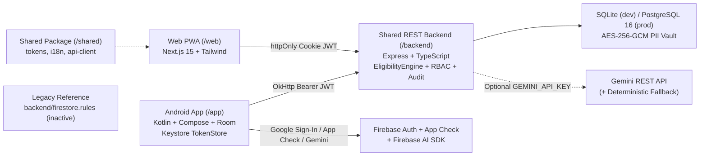

# Scheme Saathi (स्कीम साथी)

Bilingual (`hi` / `en`) civic-tech welfare scheme assistant powered by a deterministic eligibility engine, Human Confirmation Gate, and shared Android + Web architecture.

[](https://kotlinlang.org)
[](https://developer.android.com/compose)
[](https://firebase.google.com)
[](LICENSE)
[](CONTRIBUTING.md)

**Live Web Demo**: `TODO: add Netlify URL` · **Demo Video / Walkthrough**: `TODO: add demo video or GIF link` (see [docs/demo/README.md](docs/demo/README.md))

> **Disclaimer**: Scheme Saathi is **not** an official government application. Scheme rules and benefit thresholds are illustrative informational guidance; final eligibility and approvals rest solely with the issuing government authority.

---

## 🎯 The Problem

Eligible citizens often miss government welfare benefits because scheme rules span age cutoffs, state-specific income thresholds, and landholding exclusions written in dense official portals. Missing a single document or misinterpreting a rule leads to avoidable rejections or repeated visits to local centres. Scheme Saathi provides clear Hindi/English guidance, tracks document readiness upfront, and prepares a citizen-verified checklist before portal submission.

---

## ✨ Key Features

Implemented and verified across `/app`, `/web`, `/backend`, and `/shared`:

- **Deterministic Eligibility Engine**: Synchronous `ALL`/`ANY` rule-tree evaluation (`EligibilityEngine.kt` on Android, `eligibilityEngine.ts` on backend) across 5 seeded schemes (`PM-KISAN`, `NSAP-IGNOAPS`, `PMUY`, `PM-JAY`, `APY`) with state overrides and `UNKNOWN` status for missing fields.
- **Bilingual Hindi & English (`hi` / `en`)**: Centralized JSON strings (`shared/i18n/{en,hi}.json`) for Web and localized Android resources (`res/values/strings.xml`, `res/values-hi/strings.xml`), plus Large Text mode (`20px` on Web, `22sp` on Android).
- **Voice Numeral Confirmation**: On Android (`AiAndVoiceScreens.kt` + `SecurityUtils.parseHindiOrEnglishNumber`), spoken Hindi/English ages (such as `बासठ` -> `62`) trigger an echo-back gate (`"आपकी उम्र 62 साल है, सही है?"`) before confirming age; Web `/chat` supports browser `SpeechRecognition` and `speechSynthesis`.
- **Human Confirmation Gate**: Applications require explicit citizen review declarations and a deterministic SHA-256 snapshot hash (`HumanConfirmationGateModal.tsx`, `ReviewConfirmScreen`, `POST /api/v1/applications/:id/confirm`) before unlocking a CSC Guided Handoff Pack. AI never auto-submits forms.
- **PII Redaction & Aadhaar Blocking**: Rejects 12-digit Aadhaar numbers at input and REST API validation (`400 AADHAAR_FORBIDDEN`), strips names/phones/DOB/Aadhaar-like digits before LLM prompts (`redactPiiForLlm`), and blocks prompt-injection or auto-submit attempts.
- **AES-256-GCM Encrypted Profile Fields**: Encrypts sensitive profile PII (name, phone, `DD/MM/YYYY` DOB) using AES-256-GCM (`SecurityUtils.encryptPii` on Android and HMAC-keyed `crypto.ts` on backend), with age-only summaries passed to AI tools.
- **Role-Based Operator Workbench**: Supports 4 roles (`CITIZEN`, `CSC_OPERATOR`, `REVIEWER`, `SUPERVISOR`) enforced by backend RBAC middleware, with a dedicated queue and redacted audit trail at `/operator` on Web and role-gated tracking views on Android.

---

## 📸 Screenshots

The `docs/screenshots/` directory currently contains only `.gitkeep` (no captured screenshot images yet). Captured screens will be added here:

| Screen | Platform | File | Status |
|---|---|---|---|
| Landing & Scheme Explorer | Web PWA | `TODO: docs/screenshots/web-home.png` | Pending capture |
| Login (OTP & Role Demo) | Web PWA | `TODO: docs/screenshots/web-login.png` | Pending capture |
| Profile & DOB Validation | Android / Web | `TODO: docs/screenshots/profile-dob.png` | Pending capture |
| Bilingual AI Chat & Voice | Android / Web | `TODO: docs/screenshots/ai-chat.png` | Pending capture |
| Human Confirmation Gate | Android / Web | `TODO: docs/screenshots/confirmation-gate.png` | Pending capture |
| Operator / Reviewer Workbench | Web PWA | `TODO: docs/screenshots/operator-workbench.png` | Pending capture |

---

## 🏗️ Architecture

Originally prototyped as a standalone Android + Firestore app (see initial findings in [docs/AUDIT.md](docs/AUDIT.md)), the codebase now runs a unified REST backend powering both clients. Android uses `BackendApiClient` + Room offline cache + Keystore `TokenStore`, alongside `FirebaseAuth` (Credential Manager), `Firebase App Check`, and `Firebase.ai`; static `backend/firestore.rules` remain in `/backend` only as a legacy artifact after Android migrated off Cloud Firestore.



### Repository Structure

```text
saathi/
├── app/                         # Native Android Kotlin + Jetpack Compose app
│   ├── build.gradle.kts         # compileSdk 36, minSdk 24, targetSdk 36, Java 11
│   └── src/
│       ├── main/java/com/example/
│       │   ├── ai/              # SchemeSaathiAiService (Firebase.ai + offline fallback)
│       │   ├── data/local/      # Room database (SchemeSaathiDatabase)
│       │   ├── data/remote/     # OkHttp shared REST client (BackendApiClient)
│       │   ├── domain/          # Deterministic EligibilityEngine.kt
│       │   ├── security/        # Android Keystore JWT storage (TokenStore.kt)
│       │   ├── ui/              # AuthComponents, screens, ViewModel, theme
│       │   └── util/            # SecurityUtils, DateUtils, AppCheckInitializer, NotificationHelper
│       └── test/java/           # ConfirmationGateComposeTest, Phase5ParityTest, DateUtilsTest
├── backend/                     # Shared Express + TypeScript REST API (/api/v1/*)
│   ├── src/                     # Routes, RBAC middleware, crypto, piiGuard, eligibilityEngine
│   ├── openapi.yaml             # OpenAPI 3.0 contract (Swagger UI at /api/docs)
│   ├── firestore.rules          # Legacy static Firestore rules (inactive)
│   └── tests/                   # Vitest unit & integration tests
├── web/                         # Responsive Next.js 15 PWA (/web)
│   ├── src/app/                 # Routes: /, /login, /profile, /chat, /apply, /alerts, /settings, /operator
│   ├── src/components/          # AppShell, HumanConfirmationGateModal, StatusBadges
│   └── tests/e2e/               # Playwright + @axe-core/playwright suite
├── shared/                      # Shared design-tokens (JSON/CSS), i18n (en/hi), TypeScript API client
├── docs/                        # ARCHITECTURE.md, AUDIT.md, DESIGN.md, DEPLOYMENT.md, ASSUMPTIONS.md
├── .env.example                 # Environment variable template
├── docker-compose.yml           # Local PostgreSQL 16 + Backend + Web stack
├── CHECKLIST.md                 # End-to-end verification checklist
├── CONTRIBUTING.md              # Contribution guide & PR checks
└── LICENSE                      # MIT License
```

---

## 🧰 Tech Stack

| Layer | Technology (Verified in Repo) |
|---|---|
| **Android App (`/app`)** | Kotlin `2.2.10`, AGP `9.1.1`, Jetpack Compose BOM `2024.09.00` (Material 3), `compileSdk`/`targetSdk` `36`, `minSdk` `24`, Room `2.7.0`, OkHttp `4.10.0`, Coroutines `1.10.2` |
| **Firebase & Mobile Auth** | Firebase BOM `34.17.0` (`firebase-auth`, `firebase-ai`, `firebase-appcheck-recaptcha`, `firebase-appcheck-debug`), Credential Manager `1.5.0`, `googleid` `1.1.1` |
| **Web Frontend (`/web`)** | Next.js `15.3.2` (App Router), React `19.1.0`, TypeScript `5.8.3`, Tailwind CSS `4.1.6`, `lucide-react` `0.511.0`, PWA (`manifest.webmanifest`, `sw.js`) |
| **Shared Backend (`/backend`)** | Node.js `24` (with built-in `node:sqlite`), Express `4.21.2`, TypeScript `5.7.3`, PostgreSQL driver `pg` `8.13.3`, Zod `3.24.2`, `jsonwebtoken`, `swagger-ui-express`, `helmet`, `cors`, `express-rate-limit` |
| **Testing & Quality** | Vitest `3.0.5`, Supertest `7.0.0`, ESLint, Prettier `3.5.0`, Playwright `1.52.0`, `@axe-core/playwright` `4.14.0`, JUnit 4, Robolectric `4.16.1`, Compose UI Test |

---

## 🔒 Security and Privacy

Per [docs/AUDIT.md](docs/AUDIT.md) and the current implementation:

### Implemented Controls
- **Zero-Aadhaar Policy**: Rejects 12-digit Aadhaar patterns in client helpers (`SecurityUtils.containsAadhaarNumber`) and backend request payloads (`assertNoAadhaarInPayload` returning HTTP `400`).
- **AES-256-GCM PII Encryption & Token Security**:
  - Backend [`crypto.ts`](backend/src/security/crypto.ts) derives per-user keys using HMAC-SHA256 over `PII_ENCRYPTION_KEY` (required 64-hex in `NODE_ENV=production`) to encrypt profile PII with unique 12-byte random IVs.
  - Web stores sessions in `httpOnly`, `SameSite=Lax` (`Secure` in production) cookies; Android stores JWTs in hardware-backed Android Keystore AES-GCM (`TokenStore.kt`).
- **AI Safety Boundaries**: `redactPiiForLlm` scrubs names, phone numbers, `DD/MM/YYYY` dates, and Aadhaar-like sequences before Gemini calls; `detectPromptInjectionOrAutoSubmit` blocks auto-submit or rule-bypass prompts.
- **Server-Enforced RBAC & Human Gate**: Backend validates roles across `/api/v1/*` and verifies SHA-256 snapshot hashes before confirming applications.
- **DPDP Controls**: Consent management, JSON data export (`GET /api/v1/profile/export`), and personal data erasure (`DELETE /api/v1/profile`).

### Honest Gaps & Caveats (Verified in Code / `AUDIT.md`)
- **Historical vs. Current Backend State**: Early Sections 1–4 of [docs/AUDIT.md](docs/AUDIT.md) noted that no shared HTTP backend existed in the initial Android prototype. Phases 2–7 resolved that by building `/backend` and migrating Android off Cloud Firestore ([docs/AUDIT.md Section 5](docs/AUDIT.md#L155-L169)); legacy `backend/firestore.rules` remains inactive in the repo.
- **Android Helper Key Derivation**: `SecurityUtils.deriveUserKey` derives the key from a constant + `userId`, so it is weaker than the backend HMAC-based scheme; server-side PII encryption uses `PII_ENCRYPTION_KEY` in `crypto.ts` and Android JWT storage uses Android Keystore (`TokenStore.kt`).
- **Bank Account Redaction**: `redactPiiForLlm` scrubs names, phones, dates, and Aadhaar sequences, while application forms pass masked branch summaries (`bankIfscSummary`) rather than full bank account regex patterns.
- **Dev OTP Simulation**: Backend OTP login returns a `devOtpHint` for local/E2E verification rather than calling a paid SMS gateway.
- **Illustrative Scheme Rules**: Thresholds and state top-ups for all 5 schemes are illustrative until cross-checked on official portals ([docs/ASSUMPTIONS.md](docs/ASSUMPTIONS.md)).

---

## ⚙️ Getting Started

### Prerequisites
- **Node.js `22+`** (Node `24` used in `backend` for built-in `node:sqlite`) and **npm**
- **JDK 11+** and **Android SDK** (`compileSdk 36`, `minSdk 24`) for mobile builds
- Optional: **Docker** (`docker compose up --build`)

### 1. Clone & Configure Environment
```bash
git clone https://github.com/omdubey07/scheme-sathi.git
cd scheme-sathi
cp .env.example .env
```
*(In PowerShell on Windows: `copy .env.example .env`.)*

### 2. Run Shared Backend (`/backend`)
```bash
cd backend
npm ci
npm run migrate
npm run seed
npm run dev
```
Backend runs at `http://localhost:4000` with Swagger UI at `http://localhost:4000/api/docs`.

### 3. Run Web PWA (`/web`)
```bash
cd web
npm ci
npm run dev
```
Open `http://localhost:3000`. (Or launch PostgreSQL 16 + Backend + Web together via `docker compose up --build`.)

### 4. Run Android App (`/app`)
```powershell
copy app\google-services.json.example app\google-services.json
.\gradlew.bat installDebug
```
> With `google-services.json.example`, the app builds and runs against the deterministic engine, Room cache, and local backend (`http://10.0.2.2:4000/api/v1`), while live Google Sign-In and Firebase AI/App Check require your own `app/google-services.json` and registered debug SHA-1.

> **Note on Firestore Emulator Tests**: `backend/tests/firestore.test.js`, `SchemeSaathiRepositoryRuleTest.kt`, and `firebase-tools` were removed when Android migrated off Cloud Firestore onto `BackendApiClient` ([docs/AUDIT.md Section 5](docs/AUDIT.md#L155-L169)).

---

## 🧪 Testing

| Suite | Command | Latest Observed Result |
|---|---|---|
| **Backend Lint, Format & Tests** | `cd backend && npm run lint && npm run format:check && npm run build && npm test` | **PASS** — Prettier clean, TS build clean, Vitest `2` files / `15` tests passed (`eligibility.test.ts`, `api.integration.test.ts`) |
| **Web Lint, Build, Playwright & `axe-core`** | `cd web && npm run lint && npm run build && npm run test:e2e` | **PASS** — ESLint 0 errors, Next.js static/app build clean, Playwright passed across all 8 routes, 4 roles, `hi`/`en`, OTP/password/AI error states, with `0` WCAG AA `@axe-core/playwright` violations |
| **Android Unit, Robolectric & Compose UI** | `.\gradlew.bat assembleDebug testDebugUnitTest` | **PASS** — `19` passed, `0` failed, `0` skipped (`DateUtilsTest` 13, `Phase5ParityTest` 2, `ConfirmationGateComposeTest` 2, `ExampleUnitTest` 1, `ExampleRobolectricTest` 1) |

*Limitations*: Compose UI tests executed under Robolectric JVM (`testDebugUnitTest`), not physical-device `connectedAndroidTest`; release `.aab` verification used a local self-signed upload keystore.

---

## 🌐 Deployment

- **Web PWA (`/web`)**: Deploy Next.js (`Root Directory: web`, enable external workspace directory access for `/shared`) on **Netlify** or **Vercel** with `NEXT_PUBLIC_API_URL=/api/v1` and `BACKEND_URL=https://<service>.onrender.com`. Next.js `rewrites()` proxies `/api/v1/*` to `BACKEND_URL` so `httpOnly` `SameSite=Lax` auth cookies stay same-origin.
- **Backend (`/backend`)**: Deploy Express + PostgreSQL 16 on **Render**, **Railway**, **Google Cloud Run**, or **Docker Compose** with `NODE_ENV=production`, strong `JWT_SECRET` / `JWT_REFRESH_SECRET` (`>=32` chars), and 64-hex `PII_ENCRYPTION_KEY`.
- **Firebase & Play Console (`/app`)**: Keep `Firebase Auth`, `App Check` (`RecaptchaAppCheckProviderFactory`), and `Firebase AI SDK` configured with release Play App Signing SHA-1/SHA-256 fingerprints, then build a signed `.aab` (`.\gradlew.bat bundleRelease`).

Full step-by-step commands and environment checklists are in [docs/DEPLOYMENT.md](docs/DEPLOYMENT.md).

---

## 🗺️ Roadmap

Tracked from open items in [docs/DESIGN.md](docs/DESIGN.md), [docs/AUDIT.md](docs/AUDIT.md), [docs/ASSUMPTIONS.md](docs/ASSUMPTIONS.md), and [CHECKLIST.md](CHECKLIST.md):

- [ ] Implement the `/web` UI/UX redesign specified in [docs/DESIGN.md](docs/DESIGN.md) (Navy/Indigo + Warm Saffron palette, `Plus Jakarta Sans` + `Noto Sans Devanagari`, collapsible sidebar, segmented OTP, Lighthouse `>= 90` pass)
- [ ] Populate real app screenshots in `docs/screenshots/` and add live Netlify URL + walkthrough demo GIF/video in [docs/demo/README.md](docs/demo/README.md)
- [ ] Replace client-side key derivation with a server-held or Keystore-backed key
- [ ] Integrate a real SMS OTP provider to replace `devOtpHint` in production environments
- [ ] Register production Google Play App Signing SHA-1/SHA-256 in Firebase Console and complete `connectedAndroidTest` runs on real devices
- [ ] Expand `shared/i18n/` beyond `hi` and `en` (Marathi, Bengali, Tamil) and schedule quarterly verification of official scheme thresholds

---

## 🤝 Contributing

Contributions are welcome. See [CONTRIBUTING.md](CONTRIBUTING.md) for branch conventions and the PR verification checklist.

---

## 📄 License

Distributed under the **MIT License**. See [LICENSE](LICENSE) for details.

---

## 👤 Author

**Krunal Chikhale** (Dusky)
- GitHub: [@ENTRYDOWN99](https://github.com/ENTRYDOWN99)
- LinkedIn: [Krunal Chikhale](https://www.linkedin.com/in/krunal-chikhale-162b743b8/)

---

## 🙏 Acknowledgements

- Official public scheme guidelines referenced for illustrative rule trees (`pmkisan.gov.in`, `nsap.nic.in`, `pmuy.gov.in`, `beneficiary.nha.gov.in`, `npscra.nsdl.co.in`)
- Open-source maintainers of Kotlin, Jetpack Compose, Next.js, Express, Playwright, and `@axe-core/playwright`
