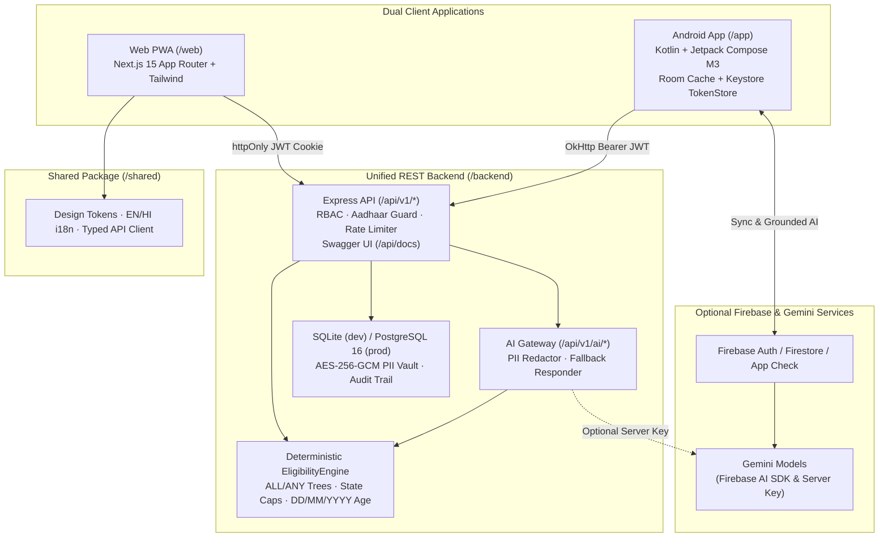

# Scheme Saathi (स्कीम साथी)

> **⚠️ DISCLAIMER**: **Not an official government app.** Scheme Saathi is an independent civic-tech assistant designed for informational guidance and demonstration. Eligibility results, financial thresholds, and benefit calculations are strictly informational and illustrative; final application decisions and benefit disbursements rest solely with the respective government issuing authorities.

[](https://developer.android.com)
[](https://nextjs.org)
[](https://expressjs.com)
[](https://kotlinlang.org)
[](https://firebase.google.com)
[](https://firebase.google.com/docs/ai)
[](LICENSE)

---

## ⚡ Judge Quick Start

> ### 🏆 For Hackathon Judges & Evaluators
>
> #### 🌐 Path A: Full-Stack Web PWA + Shared API (Fastest Local Demo)
> ```powershell
> # 1. Clone & configure environment
> git clone https://github.com/YOUR_USERNAME/saathi.git
> cd saathi
>
> # 2. Start Shared Backend (http://localhost:4000, Swagger UI at /api/docs)
> cd backend && npm ci && npm run migrate && npm run seed && npm run dev
>
> # 3. In a second terminal, start the Web PWA (http://localhost:3000)
> cd web && npm ci && npm run dev
> ```
> Or launch **PostgreSQL 16 + Backend + Web PWA** in one command with Docker:
> ```bash
> docker compose up --build
> ```
>
> #### 📱 Path B: Android APK (Pre-built Release vs Source Build)
> - **Pre-built Release APK (Recommended for Live Firebase Auth)**: Download from GitHub Releases (`TODO: https://github.com/YOUR_USERNAME/saathi/releases/latest/download/SchemeSaathi.apk`) for live Google Sign-In and Firebase sync (`.apk` is intentionally excluded from Git).
> - **Build from Source**:
>   ```powershell
>   copy app\google-services.json.example app\google-services.json
>   .\gradlew.bat assembleDebug
>   ```
>   ⚠️ When building with `app/google-services.json.example`, the APK compiles cleanly and works with the deterministic rule engine, offline fallback chat, Room cache, and local REST API (`http://10.0.2.2:4000/api/v1`), while **live Google Sign-In and Cloud Firestore will NOT authenticate** because Google Play Services and **Firebase App Check** require a registered SHA-1 and Firebase project.

---

## 📌 Overview

**Scheme Saathi** (Citizen Welfare Scheme & Collaborative Task Companion) is a full-stack bilingual (`en` / `hi`) civic-tech platform delivered in **two clients** — a responsive **Next.js PWA Website (`/web`)** and a native **Jetpack Compose Android App (`/app`)** — both powered by **one unified REST Backend (`/backend`)** and shared tokens/i18n/types (`/shared`).

Key engineering principles:
- **Deterministic Rule Engine First**: Scheme eligibility is evaluated strictly by a pure deterministic rule engine (`EligibilityEngine`) with zero AI guesswork or hallucination.
- **Grounded AI Guidance**: Gemini chat and bilingual voice Q&A are strictly grounded in deterministic eligibility and checklist outputs, with automatic deterministic fallback when offline or rate-limited.
- **Privacy By Design**: No 12-digit Aadhaar numbers are ever collected or stored across any layer; citizen PII (name, phone, `DD/MM/YYYY` DOB) is encrypted with AES-256-GCM.
- **Human Confirmation Gate**: Applications cannot be auto-submitted to government portals; citizens review every field, acknowledge uncertain items, lock a **SHA-256 snapshot hash**, and receive a Guided Handoff Package for Common Service Centres (CSC).
- **4-Role Access Control (RBAC)**: Distinct workflows for `CITIZEN`, `CSC_OPERATOR`, `REVIEWER`, and `SUPERVISOR`.

---

## 📐 Architecture & System Flow



---

## ✨ Key Features (Verified from Codebase)

1. **Deterministic 5-Scheme Rule Engine (`EligibilityEngine`)**:
   - Implemented identically across Android (`app/src/main/java/com/example/domain/EligibilityEngine.kt`) and Backend (`backend/src/domain/eligibilityEngine.ts`).
   - Evaluates `ALL` and `ANY` rule trees with `EQ`, `GTE`, `LTE`, `IN`, `BETWEEN`, and `EXTERNAL_LOOKUP` operators.
   - Missing or unconfirmed attributes strictly evaluate to `UNKNOWN` (never `NOT_ELIGIBLE`).
   - Supports dynamic current reference year and state-specific income overrides (Uttar Pradesh, Bihar, Maharashtra, Madhya Pradesh, Rajasthan).

2. **Grounded Bilingual AI & Voice Assistant (`SchemeSaathiAiService.kt` & `/api/v1/ai`)**:
   - Multi-turn streaming chat on Android via Firebase AI SDK (`gemini-3.8-flash`, `gemini-3.1-flash-lite`, `gemini-3.8-flash-tts`, `gemini-4-carbon`) and REST chat endpoint on Backend/Web.
   - Pre-prompt prompt-injection detection, 12-digit Aadhaar blocker, PII redaction, central user-friendly error mapping (`busy` / `network` / `generic`), and deterministic offline fallback.
   - Android voice confirmation gate: extracts Hindi/English spoken numerals and requires explicit echo-back confirmation before updating profile age.

3. **Profile (`DD/MM/YYYY` DOB) & Document Checklist (`Have` / `Missing` / `Unknown`)**:
   - Strict calendar validation (`DateUtils`), leap-year/future checks, exact age calculation accounting for upcoming birthdays, and encrypted DOB storage.
   - Offline-cached Android document checklist via **Room (`SchemeSaathiDatabase`)** and full checklist persistence via `PUT /api/v1/checklists/:schemeId`.

4. **Human Confirmation Gate & CSC Guided Handoff Pack**:
   - Requires explicit citizen declarations (`reviewedFields`, `acknowledgedUnknowns`, `confirmNoAutoSubmit`) to lock an immutable **SHA-256 snapshot hash** and generate a CSC Handoff Pack.
   - Blocks AI from auto-submitting or self-approving any application.

5. **Role-Based Operations, Alerts/Tasks & Audit Log**:
   - Roles: `CITIZEN`, `CSC_OPERATOR`, `REVIEWER`, `SUPERVISOR`.
   - Operator Desk (`/operator` on Web, RBAC controls on Android) for acknowledging/reviewing/approving applications (`REVIEWER` and `SUPERVISOR` only for `APPROVED`).
   - Collaborative task alerts with Android local notifications (`NotificationHelper`) and DPDP JSON data export + CSV security audit log export.

---

## 👥 Role-Wise User Guide

| Role | Access Scope | Primary Screens / Actions |
|---|---|---|
| **Citizen (`CITIZEN`)** | Own profile, checklists, draft applications, tasks, AI chat, DPDP export | Complete profile (`DD/MM/YYYY`), check 5 schemes, manage document checklist, submit Human Confirmation Gate Handoff Pack, view tasks & export personal JSON |
| **CSC Operator (`CSC_OPERATOR`)** | Assisted citizen intake & operational triage (`ACKNOWLEDGED` / `IN_PROGRESS` tasks) | Web `/operator` desk & Android Application Tracking; acknowledge submitted handoff packs, create/update citizen preparation tasks |
| **Reviewer (`REVIEWER`)** | Application verification & decisioning | Inspect SHA-256 snapshot hashes and rule outcomes; advance applications to `APPROVED`, `NEEDS_INFO`, or `REJECTED` |
| **Supervisor (`SUPERVISOR`)** | Full operational oversight & security/audit review | All Reviewer actions + inspect PII-redacted security audit logs (`/api/v1/audit`, CSV export) |

---

## 🏛️ Supported Welfare Schemes

| Scheme Code | Scheme Name & Ministry | Illustrative Benefits | Core Eligibility Criteria | Official Source Portal |
|---|---|---|---|---|
| **PM-KISAN** | Pradhan Mantri Kisan Samman Nidhi *(Ministry of Agriculture & Farmers Welfare)* | ₹6,000 / year in 3 DBT installments | Age ≥ 18, owns cultivable land, not an income-tax payer, active bank account | [pmkisan.gov.in](https://pmkisan.gov.in) |
| **NSAP-IGNOAPS** | Indira Gandhi National Old Age Pension Scheme *(Ministry of Rural Development)* | Central ₹200–₹500/mo + State top-up | Age ≥ 60, BPL household, annual income within state cap (UP, Bihar, MH, MP, RJ overrides) | [nsap.nic.in](https://nsap.nic.in) |
| **PMUY** | Pradhan Mantri Ujjwala Yojana 2.0 *(Ministry of Petroleum & Natural Gas)* | Deposit-free LPG connection + refill/stove assistance | Adult woman (Age ≥ 18), no existing LPG connection, BPL or SC/ST/deprived category | [pmuy.gov.in](https://www.pmuy.gov.in) |
| **PM-JAY** | Ayushman Bharat - PM Jan Arogya Yojana *(National Health Authority)* | Up to ₹5 Lakh cashless hospitalization cover/family/yr | BPL/NFSA household, senior citizen age 70+ (Vaya Vandana), or SECC-2011/NFSA lookup | [beneficiary.nha.gov.in](https://beneficiary.nha.gov.in) |
| **APY** | Atal Pension Yojana *(PFRDA / NPS Trust)* | Guaranteed monthly pension ₹1,000–₹5,000 after age 60 | Entry age 18–40, unorganized sector worker, savings bank account, non-taxpayer | [npscra.nsdl.co.in](https://npscra.nsdl.co.in) |

---

## 🛡️ Security & Privacy Architecture

1. **No Aadhaar Number Collection/Storage**:
   - Blocked in UI/input forms, regex-rejected at REST middleware (`noAadhaarMiddleware` returning `400 NO_AADHAAR_POLICY`), and rejected in Cloud Firestore (`backend/firestore.rules` `incoming().keys().hasOnly([...])`).
2. **AES-256-GCM PII Encryption & Minimal Logging**:
   - **Android (`SecurityUtils.kt`)**: Per-user key via SHA-256 over `"scheme-saathi-vault-v1:$userId"`, `AES/GCM/NoPadding`, unique 12-byte `SecureRandom` IV, 128-bit auth tag.
   - **Backend (`backend/src/security/crypto.ts`)**: AES-256-GCM encryption for stored `fullName`, `phone`, `dob`, validated against a 64-hex `PII_ENCRYPTION_KEY` in production.
   - **Token Storage**: Web uses `httpOnly` session cookies; Android stores backend JWTs in **Android Keystore (`TokenStore.kt`)**.
   - **Log Hygiene (`FirestoreErrorHandler.kt`)**: PII (`userId`, `email`, raw exception strings) redacted before `Log.e`.
3. **LLM PII Redaction (`SecurityUtils.kt` & `backend/src/security/piiGuard.ts`)**:
   - Strips citizen names, phone numbers (`[6-9]\d{9}`), Aadhaar patterns (`\d{4}[\s-]?\d{4}[\s-]?\d{4}`), and bank accounts before sending prompts to Gemini.
4. **Firebase App Check (`AppCheckInitializer.kt`)**:
   - Uses `DebugAppCheckProviderFactory` in debug builds and `RecaptchaAppCheckProviderFactory` in release builds.

---

## 🤖 AI & Voice Engine

- **Android Firebase AI SDK (`SchemeSaathiAiService.kt`)** — configured with verbatim model identifiers:
  - `gemini-3.8-flash` (primary bilingual streaming chat, High Thinking, voice turns)
  - `gemini-3.1-flash-lite` (low-latency fallback)
  - `gemini-3.8-flash-tts` (TTS script generation paired with Android `TextToSpeech` `hi-IN` / `en-IN`)
  - `gemini-4-carbon` (deep reasoning chain: `gemini-4-carbon` -> `gemini-3.8-flash` -> `gemini-3.1-flash-lite`)
- **Zero Hardcoded API Keys**: Android contains zero Gemini/OpenAI API keys in source, Gradle, or resource XML. Backend `/api/v1/ai/*` optionally reads `GEMINI_API_KEY` from environment variables on the server and automatically falls back to deterministic grounded answers if unconfigured or unavailable.

---

## 📖 API Documentation (OpenAPI / Swagger)

When `/backend` is running (default `http://localhost:4000`):
- **Swagger UI**: `http://localhost:4000/api/docs`
- **OpenAPI 3.0 Spec (JSON / YAML)**: `http://localhost:4000/api/openapi.json` and [backend/openapi.yaml](backend/openapi.yaml)
- **Health Check**: `GET /health`
- **Versioned Endpoints (`/api/v1`)**:
  - `POST /auth/demo-login`, `POST /auth/logout`, `GET /auth/me`
  - `GET /profile`, `PUT /profile`, `GET /profile/export` (DPDP export)
  - `GET /schemes`, `POST /schemes/evaluate`
  - `GET /checklists/:schemeId`, `PUT /checklists/:schemeId`
  - `GET /applications`, `POST /applications`, `PATCH /applications/:id/review`
  - `GET /tasks`, `POST /tasks`, `PATCH /tasks/:id`
  - `POST /ai/chat`, `POST /ai/voice-summary`
  - `GET /audit`, `GET /audit/export`

---

## 📱 Tech Stack & Versions

- **Backend (`/backend`)**: Node.js, TypeScript 5.7, Express 4.21, Zod 3.24, JWT (`jsonwebtoken`), SQLite (`node:sqlite`) & PostgreSQL 16 (`pg`), Swagger UI, Vitest, Supertest.
- **Web PWA (`/web`)**: Next.js 15.3 (App Router, standalone output), React 19, TypeScript 5.8, Tailwind CSS v4, Lucide Icons, PWA manifest & service worker, Playwright E2E.
- **Shared (`/shared`)**: Design tokens (`tokens.json` / `tokens.css`), bilingual EN/HI dictionaries, typed TypeScript API client (`shared/api-client/index.ts`).
- **Android (`/app`)**: Kotlin 2.2.10, AGP 9.1.1, Jetpack Compose Material 3, compileSdk 36 / targetSdk 36 / minSdk 24, Room offline cache, OkHttp, Android Keystore, CredentialManager + Firebase Auth, Cloud Firestore, Firebase App Check, Firebase AI SDK.

---

## 🧪 Testing & Verification

| Suite | Command | Latest Observed Result |
|---|---|---|
| **Backend Lint & Type Build** | `cd backend && npm run lint && npm run build` | **PASS** (0 lint errors/warnings, `dist/` built cleanly) |
| **Backend Unit & API Integration** | `cd backend && npm test` | **PASS** (`2` files, `15 passed`: `eligibility.test.ts` 9 + `api.integration.test.ts` 6) |
| **Shared Types Check** | `backend\node_modules\.bin\tsc.cmd -p shared\tsconfig.json` | **PASS** (exit code 0) |
| **Web PWA Lint & Build** | `cd web && npm run lint && npm run build` | **PASS** (0 ESLint errors/warnings; 11 routes built cleanly) |
| **Web E2E (Playwright Chromium)** | `cd web && npm run test:e2e` | **PASS** (`1 passed` full flow: catalog, EN/HI switch, login, DOB validation, profile, 3-checkbox Handoff Pack, AI block, Reviewer RBAC approval) |
| **Android Build & JVM/Robolectric Tests** | `.\gradlew.bat assembleDebug testDebugUnitTest --tests "com.example.Phase5ParityTest" --tests "com.example.util.DateUtilsTest" --tests "com.example.ExampleUnitTest" --tests "com.example.ExampleRobolectricTest"` | **PASS** (`17 passed`: `DateUtilsTest` 13, `Phase5ParityTest` 2, `ExampleUnitTest` 1, `ExampleRobolectricTest` 1) |
| **Android & Firestore Emulator Rules** | `cd backend && npm run test:rules` and `SchemeSaathiRepositoryRuleTest` | **Emulator-dependent** (not executed in local CI run because Firebase Emulator Java runtime for `127.0.0.1:8085` is not started automatically) |

---

## 🚀 Deployment

See [docs/DEPLOYMENT.md](docs/DEPLOYMENT.md) for step-by-step instructions covering:
- Production **Docker Compose** (PostgreSQL 16 + Backend + Web PWA)
- Bare-metal / VM deployment & health checks
- Android signed Release `.aab` / `.apk` build & API endpoint configuration

For the phase-by-phase verification matrix, see [CHECKLIST.md](CHECKLIST.md).

---

## 📂 Repository Structure

```
saathi/
├── app/                         # Native Android Kotlin + Jetpack Compose app
│   ├── src/main/java/com/example/
│   │   ├── ai/                  # SchemeSaathiAiService (Firebase AI SDK + fallback)
│   │   ├── data/local/          # Room offline checklist cache (SchemeSaathiDatabase)
│   │   ├── data/remote/         # OkHttp shared REST API client (BackendApiClient)
│   │   ├── data/model/          # SchemeModels
│   │   ├── data/repository/     # Firestore sync & redacted ErrorHandler
│   │   ├── domain/              # Deterministic EligibilityEngine
│   │   ├── security/            # Android Keystore JWT store (TokenStore)
│   │   ├── ui/                  # Compose screens, ViewModel, Civic theme
│   │   └── util/                # SecurityUtils, DateUtils, NotificationHelper, AppCheck
│   └── src/test/java/           # Phase5ParityTest, DateUtilsTest, Robolectric & Unit tests
├── backend/                     # Shared REST API, eligibility engine, SQL migrations & Firebase rules
│   ├── src/                     # Express app, routes, crypto/piiGuard, SQLite/PG adapter
│   ├── openapi.yaml             # OpenAPI 3.0 contract (served at /api/docs)
│   ├── tests/                   # Vitest unit/integration tests + Firestore rules tests
│   └── Dockerfile
├── web/                         # Responsive Next.js 15 PWA frontend
│   ├── src/app/                 # Routes: /, /login, /profile, /chat, /apply, /alerts, /settings, /operator
│   ├── public/                  # PWA manifest.webmanifest, sw.js, icon.svg
│   ├── tests/e2e/               # Playwright end-to-end tests
│   └── Dockerfile
├── shared/                      # Shared design tokens (JSON/CSS), EN/HI i18n, typed TypeScript client
├── docs/                        # AUDIT.md, ARCHITECTURE.md, DEPLOYMENT.md, ASSUMPTIONS.md
├── .github/workflows/ci.yml     # CI pipeline (backend, web build + E2E, Android debug + unit tests)
├── docker-compose.yml           # PostgreSQL 16 + Backend + Web stack
├── CHECKLIST.md                 # End-to-end delivery & verification checklist
├── .env.example                 # Documented environment template
└── LICENSE                      # MIT License
```

---

## ⚖️ License & Acknowledgments

- Licensed under the [MIT License](LICENSE).
- Government scheme data and benefit definitions are based on publicly available welfare portals under the Government of India.
