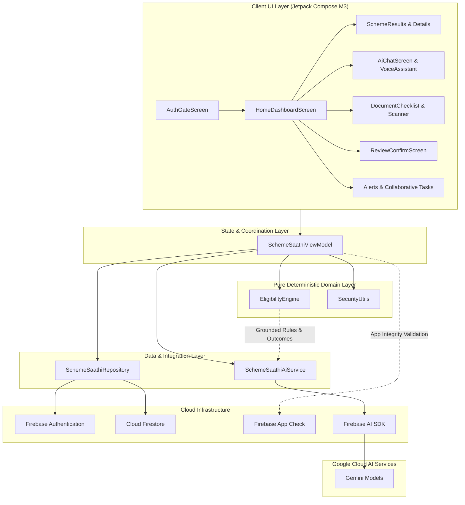

# Scheme Saathi (स्कीम साथी)

> **⚠️ DISCLAIMER**: **Not an official government app.** Scheme Saathi is an independent civic-tech assistant designed for hackathon demonstration. Eligibility results, financial thresholds, and benefit calculations are strictly informational and illustrative; final application decisions and benefit disbursements rest solely with the respective government issuing authorities.

[](https://developer.android.com)
[](https://kotlinlang.org)
[](https://developer.android.com/jetpack/compose)
[](https://firebase.google.com)
[-8E75C2?style=flat&logo=google&logoColor=white)](https://firebase.google.com/docs/ai)
[](https://opensource.org/licenses/MIT)

---

## ⚡ Judge Quick Start

> ### 🏆 For Hackathon Judges & Evaluators:
>
> #### 🚀 Path A: Fastest Evaluation (Recommended)
> Download the pre-built, signed APK directly from GitHub Releases:
> - **Download Link**: `TODO: https://github.com/YOUR_USERNAME/saathi/releases/latest/download/SchemeSaathi.apk`
> - **Why this path?** This APK is pre-signed with the registered SHA-1 certificate, allowing **real Google Sign-In** and **live Firebase backend sync** to work immediately on any Android phone (Android 7.0+ / API 24+).
> *(Note: The `.apk` file is intentionally excluded from the Git repository history to maintain a clean codebase).*
>
> #### 🛠️ Path B: Build from Source
> ```powershell
> # 1. Clone repository
> git clone https://github.com/YOUR_USERNAME/saathi.git
> cd saathi
>
> # 2. Copy the template Firebase configuration
> copy app\google-services.json.example app\google-services.json
>
> # 3. Build the debug APK
> .\gradlew.bat assembleDebug
> ```
> ⚠️ **Important Note on Building with the Example Config**:
> When building from source with `app/google-services.json.example`, the project compiles cleanly and offline features (deterministic eligibility engine, offline fallback chat, UI navigation) function as expected. However, **live Google Sign-In and Cloud Firestore will NOT authenticate with the example file** because Google Play Services and **Firebase App Check** strictly enforce that the Android app's signing certificate SHA-1 and OAuth client ID match a live registered Firebase project in the cloud. To enable live auth in your own build, see [Connecting Your Own Firebase Project](#connecting-your-own-firebase-project).

---

## 📌 Overview

**Scheme Saathi** (Citizen Welfare Scheme & Collaborative Task Companion) is a native Android application built to bridge the discovery and access gap between Indian citizens and social welfare entitlements.

Many eligible citizens miss out on essential welfare entitlements due to discovery barriers, complex multi-conditional eligibility criteria, language constraints, and administrative friction. Scheme Saathi addresses this with a **deterministic-first, AI-assisted architecture**:
- **Deterministic Rule Engine**: Eligibility is evaluated strictly by a deterministic rule engine (never left to AI hallucination).
- **Gemini AI Grounding**: Natural language conversation and document photo analysis grounded exclusively in authoritative rule outcomes.
- **Privacy By Design**: No Aadhaar numbers are ever collected or stored; citizen identifiers (Name, Phone) are encrypted with per-user AES-256-GCM.
- **Human Confirmation Gate**: Applications cannot be automatically submitted to government portals; citizens verify all fields and receive a structured Guided Handoff Package for Common Service Centres (CSC).

---

## 📐 Architecture & System Flow



---

## ✨ Key Features (Verified from Codebase)

1. **Deterministic 5-Scheme Rule Engine (`EligibilityEngine.kt`)**:
   - Pure, synchronous, I/O-free evaluator implementing `ALL` and `ANY` combinators.
   - Evaluates operators (`EQ`, `GTE`, `LTE`, `IN`, `BETWEEN`, `EXTERNAL_LOOKUP`).
   - Missing fields and unconfirmed voice data always evaluate to `UNKNOWN` (never `NOT_ELIGIBLE`).
   - State-specific income cap overrides for Uttar Pradesh, Bihar, Maharashtra, Madhya Pradesh, and Rajasthan.

2. **Grounded Gemini AI Assistant (`SchemeSaathiAiService.kt`)**:
   - Multi-turn streaming chat grounded strictly in deterministic tool results (`check_eligibility`, `get_profile_summary`, `get_required_documents`).
   - Pre-prompt safety filters: prompt-injection detection, Aadhaar number blocker, and automated PII redaction.
   - Deterministic offline summary fallback if AI times out (60s) or encounters connectivity issues.

3. **Spoken Voice Guidance & Confirmation Gate (`AiAndVoiceScreens.kt`)**:
   - Indian numeral extraction supporting Hindi spoken words (e.g., `बासठ` = 62) and English digits.
   - Mandatory echo-back confirmation gate (*"आपकी उम्र 62 साल है, सही है?"*) before voice attributes are accepted.
   - Spoken audio script preparation paired with Android `TextToSpeech` (`hi-IN` / `en-IN`).

4. **Zero-Permission Document Photo Inspection**:
   - Integrates Android Activity Result `PickVisualMedia` photo picker (no broad storage permissions needed).
   - Visual inspection of uploaded documents (Khatauni, BPL ration cards, passbooks) with automatic Aadhaar redaction.

5. **Human Confirmation Gate & Guided Handoff Pack (`ApplicationAndTasksScreens.kt`)**:
   - Enforces explicit citizen checkbox review and acknowledgment of uncertain fields.
   - Computes deterministic **SHA-256 snapshot hash** over form fields and checklist data for audit traceability.
   - Generates a structured Guided Handoff Pack with portal instructions and CSC operator guidance.

6. **Collaborative Civic Tasks & Audit Logging**:
   - Role-based task management (`CITIZEN`, `CSC_OPERATOR`, `SUPERVISOR`, `REVIEWER`).
   - In-app task status advancement with due dates and delivery channels.
   - One-click CSV export of security audit findings and task logs.

---

## 🏛️ Supported Welfare Schemes

Scheme Saathi seeds 5 core government welfare schemes with deterministic rule trees and official portal integrations:

| Scheme Code | Scheme Name & Ministry | Illustrative Benefits | Core Eligibility Criteria | Official Source Portal |
|---|---|---|---|---|
| **PM-KISAN** | Pradhan Mantri Kisan Samman Nidhi *(Ministry of Agriculture & Farmers Welfare)* | ₹6,000 / year in 3 direct benefit transfer (DBT) installments | Age ≥ 18, owns cultivable land, not an income-tax payer, active bank account | [pmkisan.gov.in](https://pmkisan.gov.in) |
| **NSAP-IGNOAPS** | Indira Gandhi National Old Age Pension Scheme *(Ministry of Rural Development)* | Central ₹200–₹500/mo + State top-up (e.g. ₹500–₹1,000/mo) | Age ≥ 60, BPL household, annual income within state threshold (UP, Bihar, MH, MP, RJ overrides) | [nsap.nic.in](https://nsap.nic.in) |
| **PMUY** | Pradhan Mantri Ujjwala Yojana 2.0 *(Ministry of Petroleum and Natural Gas)* | Deposit-free LPG connection + first refill and stove assistance | Adult woman (Age ≥ 18), no existing LPG connection in household, BPL or SC/ST/deprived category | [pmuy.gov.in](https://www.pmuy.gov.in) |
| **PM-JAY** | Ayushman Bharat - PM Jan Arogya Yojana *(National Health Authority)* | Up to ₹5 Lakh cashless hospitalization cover per family per year | BPL/NFSA household, senior citizen aged 70+ (Vaya Vandana), or low income; requires SECC-2011/NFSA lookup | [beneficiary.nha.gov.in](https://beneficiary.nha.gov.in) |
| **APY** | Atal Pension Yojana *(PFRDA / NPS Trust)* | Guaranteed monthly pension of ₹1,000–₹5,000 after age 60 | Entry age 18–40, unorganized sector worker, savings bank account for auto-debit, not an income-tax payer | [npscra.nsdl.co.in](https://www.npscra.nsdl.co.in) |

---

## 🛡️ Security & Privacy Architecture

Security and citizen protection are built into the foundation of Scheme Saathi:

### 1. No Aadhaar Number Storage
- In strict adherence to privacy rules, the app **never asks for, accepts, or stores 12-digit Aadhaar numbers**.
- **Client-Side Regex Guard** (`SecurityUtils.containsAadhaarNumber`): any 12-digit sequence entered into forms or chat is detected via regex and immediately blocked.
- **Database Schema Enforcement** (`backend/firestore.rules`): Firestore rules use `incoming().keys().hasOnly([...])` strict field validation. Any document containing an unauthorized field such as `aadhaar` is rejected at the database boundary.

### 2. Field-Level AES-256-GCM Encryption
- Sensitive citizen identifiers (Name, Phone number) are encrypted locally using **AES-256-GCM** before being saved to Cloud Firestore.
- **Key Derivation (as implemented in `SecurityUtils.kt#L22-L48`)**:
  - The encryption key is derived per authenticated user by taking a **SHA-256** hash over the salt string `"scheme-saathi-vault-v1:$userId"`.
  - Encryption uses `Cipher.getInstance("AES/GCM/NoPadding")` with a **unique 12-byte initialization vector (IV)** generated per encryption call using `SecureRandom`.
  - Includes a **128-bit authentication tag**.
  - Ciphertext is stored as `"GCM1:"` followed by Base64-encoded `IV + CipherText + Tag`.

### 3. PII Redaction Before LLM Calls (`SecurityUtils.kt#L83-L96`)
- Personal identifiers are automatically sanitized before any prompt is dispatched to Gemini:
  - Citizen name: replaced with `[REDACTED_NAME]`
  - Citizen phone: replaced with `[REDACTED_PHONE]`
  - 10-digit Indian mobile numbers (`\b[6-9]\d{9}\b`): replaced with `[REDACTED_PHONE]`
  - 12-digit Aadhaar-like sequences (`\b\d{4}[\s-]?\d{4}[\s-]?\d{4}\b`): replaced with `[REDACTED_AADHAAR_FORBIDDEN]`

### 4. Firebase App Check Protection (`AppCheckInitializer.kt`)
- Backend resources (Firestore, Gemini AI) are guarded by **Firebase App Check** initialized at startup:
  - **Debug builds**: Uses `DebugAppCheckProviderFactory` with optional intent extra secret token support (`DEBUG_SECRET_KEY`).
  - **Release builds**: Uses `RecaptchaAppCheckProviderFactory` with a Google reCAPTCHA Enterprise site key.

### 5. Human Confirmation Gate
- Scheme Saathi **does not** automatically submit applications to government servers.
- The **Review & Confirm Screen** calculates a **SHA-256 snapshot hash** over all form fields, document statuses, and user declarations (`SecurityUtils.computeSnapshotHash`).
- Requires explicit citizen confirmation and acknowledgment of uncertain fields to generate a structured **Guided Handoff Pack** for submission at an authorized Common Service Centre (CSC) or official portal.

---

## 🤖 AI & Voice Engine (Firebase AI SDK)

Scheme Saathi is **designed to run on free-tier Gemini via Firebase AI SDK (`Firebase.ai`)**:

### Models Configured (Verbatim code identifiers from `SchemeSaathiAiService.kt`):
- **`gemini-3.8-flash`**:
  - Standard bilingual conversational multi-turn chat (`generateContentStream`).
  - High Thinking mode configured with `ThinkingLevel.HIGH` for deep reasoning.
  - Multimodal document photo analysis (extracting certificate types, legibility, and details from photos while redacting any Aadhaar sequences).
  - Real-time spoken voice turn processing.
- **`gemini-3.1-flash-lite`**:
  - Ultra-fast low-latency responses for quick eligibility Q&A.
- **`gemini-3.8-flash-tts`** + Android `TextToSpeech`:
  - Generates culturally natural Hindi (`hi-IN`) and English (`en-IN`) spoken audio scripts before playback via Android's local TTS engine.

### Zero Hardcoded API Keys
The application stores **zero Gemini or OpenAI API keys in code, Gradle files, or resource strings**. All generative AI calls route through the official Firebase AI SDK, which authenticates through Firebase App Check and Google Play Services.

---

## 📸 Demo & Screenshots

> **📹 Video Walkthrough**: `TODO: Add your YouTube / Loom / Google Drive demo video link here`

| Screen | Description | Path |
|---|---|---|
| **Google Auth Gate** | Clean Credential Manager sign-in with privacy notice | `docs/screenshots/01_auth_gate.png` |
| **Home Dashboard** | Citizen welfare overview, scheme cards, audio summary | `docs/screenshots/02_home_dashboard.png` |
| **Eligibility Results** | Rule-by-rule breakdown with state overrides & missing fields | `docs/screenshots/03_eligibility_breakdown.png` |
| **Bilingual AI Chat** | Multi-turn streaming chat grounded in deterministic engine facts | `docs/screenshots/04_ai_chat.png` |
| **Voice Echo Gate** | Hindi spoken numeral input with mandatory confirmation gate | `docs/screenshots/05_voice_confirmation.png` |
| **Review & Handoff** | SHA-256 snapshot hash, citizen confirmation, and CSC handoff pack | `docs/screenshots/06_human_confirmation_gate.png` |

*(Place screenshot images in `docs/screenshots/` to display in your repository).*

---

## 📱 Tech Stack & Versions

- **Language**: Kotlin 2.2.10
- **Android Gradle Plugin (AGP)**: 9.1.1
- **Compile SDK**: 36
- **Target SDK**: 36
- **Min SDK**: 24 (Android 7.0+)
- **JDK Compatibility**: Java 11 bytecode compatibility (`sourceCompatibility = JavaVersion.VERSION_11`, built with JDK 17/21)
- **UI Toolkit**: Jetpack Compose with Material Design 3 (M3)
- **Authentication**: Android Jetpack `CredentialManager` (Google Sign-In) + Firebase Auth
- **Database**: Cloud Firestore with real-time snapshot listeners
- **App Integrity**: Firebase App Check (`DebugAppCheckProviderFactory` + `RecaptchaAppCheckProviderFactory`)
- **Generative AI**: Firebase AI SDK (`Firebase.ai`)
- **Audio & Voice**: Android `TextToSpeech` + Gemini TTS script synthesis

---

## 🚀 Building from Source

### Prerequisites
- **JDK**: Java 17 or Java 21
- **Android Studio**: Ladybug / Meerkat or command-line Android SDK (API 36 / Build Tools 36.0.0)
- **Android Device / Emulator**: Android 7.0+ (API level 24 or higher)

### 1. Build the Debug APK
```powershell
# Windows
copy app\google-services.json.example app\google-services.json
.\gradlew.bat assembleDebug

# Linux / macOS
cp app/google-services.json.example app/google-services.json
chmod +x gradlew
./gradlew assembleDebug
```
The resulting APK will be generated at:
```
app/build/outputs/apk/debug/app-debug.apk
```

> **Note on Keystores for Fresh Clones**: `app/build.gradle.kts` automatically detects whether a local custom keystore exists. If absent, it gracefully defaults to standard Android debug signing so the project builds out of the box on any fresh clone without manual keystore configuration.

### 2. Connecting Your Own Firebase Project
To test live Google Sign-In and Cloud Firestore with your own Firebase project:
1. Go to the [Firebase Console](https://console.firebase.google.com/) and create a project.
2. Register an Android App with package name:
   ```
   com.aistudio.schemesaathi.kxmzpq
   ```
3. Add your debug SHA-1 signing certificate fingerprint.
4. Enable **Google** under **Authentication → Sign-in method**.
5. Download your real `google-services.json` and place it in the `app/` folder.

---

## 🧪 Testing

### 1. Android Unit Tests
Run local JVM unit tests via Gradle:
```powershell
# Run pure JVM unit tests:
.\gradlew.bat testDebugUnitTest --tests com.example.ExampleUnitTest
```

> **Test Suite Status & Emulator Dependency**:
> - **Pure JVM Unit Tests (`com.example.ExampleUnitTest`)**: **PASS ✅** (`addition_isCorrect`).
> - **Robolectric Firestore Tests (`SchemeSaathiRepositoryRuleTest.kt`)**: Extends `FirestoreEmulatorTestBase.kt` which connects to `127.0.0.1:8085`. This suite requires the local Firestore Emulator to be running; running without the emulator will cause connection timeouts.

### 2. Backend Firestore Security Rules Unit Tests
The repository includes an automated rules test suite (`backend/tests/firestore.test.js`) verifying zero-trust access control:
- Unauthenticated users cannot read or write profiles, applications, or tasks.
- Users can only access their own user-scoped subcollections (`users/{userId}/*`).
- 12-digit Aadhaar fields are strictly rejected at the database rule boundary.

```bash
cd backend
npm ci
npm test
```
- **Requirements**: Node.js 18+ and Java 11+ (required by the Firestore emulator engine).
- **Environment Status**: The `npm test` script runs `firebase emulators:exec --only firestore "node --test tests/firestore.test.js"` using the local `firebase-tools` devDependency. Full emulator execution was **not run** during build verification due to absence of the local Firestore emulator runtime.

---

## 🗺️ Future Roadmap

- [ ] **DigiLocker Integration**: Direct citizen-authorized retrieval of land records (Bhulekh) and caste/income certificates via the official DigiLocker API.
- [ ] **Pan-India Scheme Expansion**: Expand rule catalog from the initial 5 schemes to 50+ state welfare schemes covering education, disability, and housing across all states.
- [ ] **Offline Edge Voice Models**: Incorporate on-device Whisper or Gemini Nano models for speech recognition in remote rural areas with no 4G/5G connectivity.
- [ ] **UMANG / CSC API Bridge**: Guided direct handoff into official state service delivery portals through UMANG APIs.

---

## 👥 Team & Contributors

- **Lead Developer**: Krunal Chikhale — *Full-Stack Android, Jetpack Compose, Firebase & AI Grounding*
- **Team / Collaborators**: `TODO: Add additional team members or leave as individual project`
- **Mentor / Guide**: `TODO: Add Project Guide / Mentor Name`

---

## 📂 Repository Structure

```
saathi/
├── app/
│   ├── google-services.json.example   # Safe Firebase template for fresh clones
│   ├── build.gradle.kts               # Android application configuration & dependencies
│   └── src/main/
│       ├── AndroidManifest.xml        # Permissions, themes, Application declaration
│       ├── java/com/example/
│       │   ├── MainActivity.kt        # Edge-to-edge entry point, App Check init, compose root
│       │   ├── ai/
│       │   │   └── SchemeSaathiAiService.kt   # Multi-model Gemini grounding & TTS engine
│       │   ├── data/
│       │   │   ├── model/SchemeModels.kt      # CitizenProfile, Scheme, Application, Task models
│       │   │   └── repository/                # Cloud Firestore sync & error handler
│       │   ├── domain/
│       │   │   └── EligibilityEngine.kt       # 5-scheme deterministic rule engine
│       │   ├── ui/
│       │   │   ├── auth/AuthComponents.kt     # CredentialManager Google Sign-In button
│       │   │   ├── screens/                   # 15 Jetpack Compose screens
│       │   │   └── theme/                     # Civic color palette, typography & theme
│       │   └── util/
│       │       ├── AppCheckInitializer.kt     # Debug & production Firebase App Check setup
│       │       └── SecurityUtils.kt           # AES-256-GCM, Aadhaar guard, SHA-256 snapshot
│       └── res/                               # Hindi/English strings, drawables, XML layouts
├── backend/                                   # Firebase configuration & security rules
│   ├── firestore.rules                        # Zero-trust Cloud Firestore security rules
│   ├── firebase.json                          # Emulator & database configuration
│   ├── firebase-blueprint.json                # Schema and data model blueprint
│   ├── package.json                           # Rules testing scripts & local firebase-tools
│   ├── package-lock.json                      # Locked dependencies for npm ci
│   └── tests/
│       └── firestore.test.js                  # Rules unit test suite (@firebase/rules-unit-testing)
├── docs/                                      # Architecture, assumptions, and design notes
│   ├── demo/                                  # Demo video link & demonstration walkthrough
│   │   └── README.md
│   ├── screenshots/                           # Directory for user interface screen captures
│   │   └── .gitkeep
│   ├── ARCHITECTURE.md                        # Architectural specification
│   ├── ASSUMPTIONS.md                         # Verification boundaries & assumptions
│   ├── PROGRESS.md                            # Development progress tracker
│   └── SECURITY_AUDIT_FINDINGS.csv            # Security audit findings report
├── .env.example                               # Environment configuration template
├── LICENSE                                    # MIT License (Krunal Chikhale)
├── build.gradle.kts                           # Root Gradle project configuration
├── settings.gradle.kts                        # Plugin and repository management
└── gradlew / gradlew.bat                      # Gradle wrapper executables
```

---

## ⚖️ License & Acknowledgments

- Licensed under the [MIT License](LICENSE).
- Government scheme data and benefit definitions are based on publicly available welfare portals under the Government of India.
